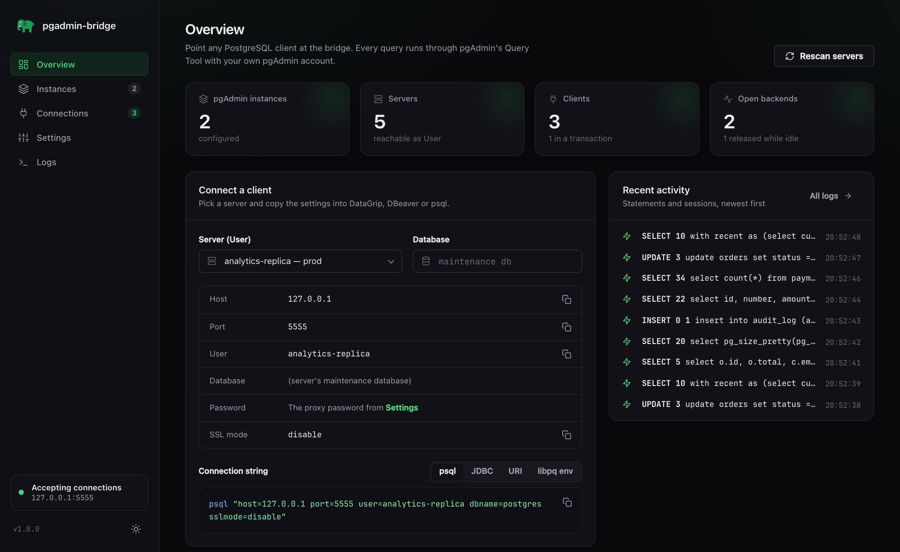
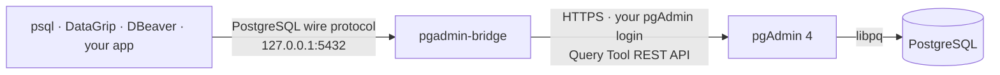
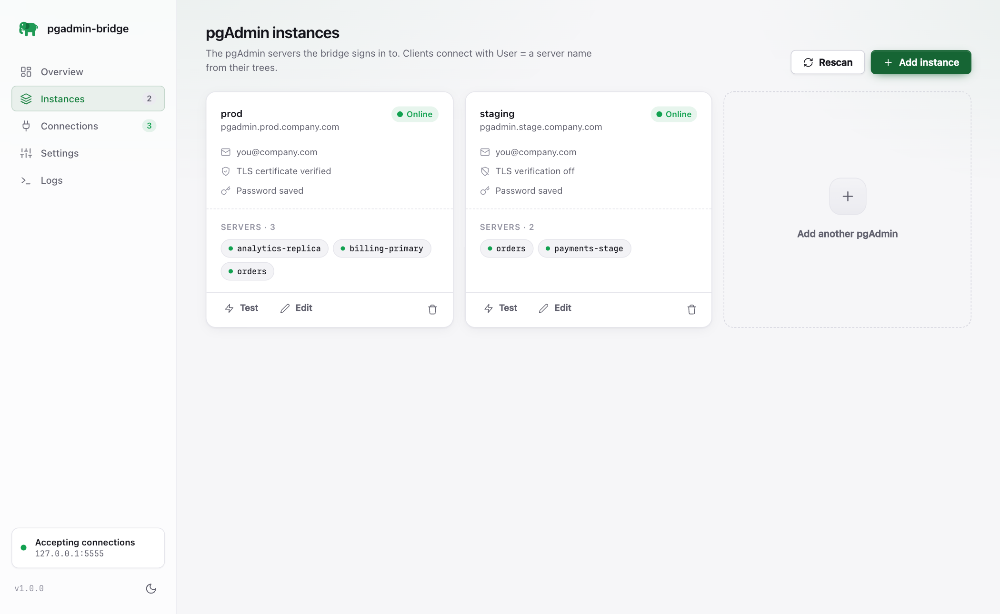
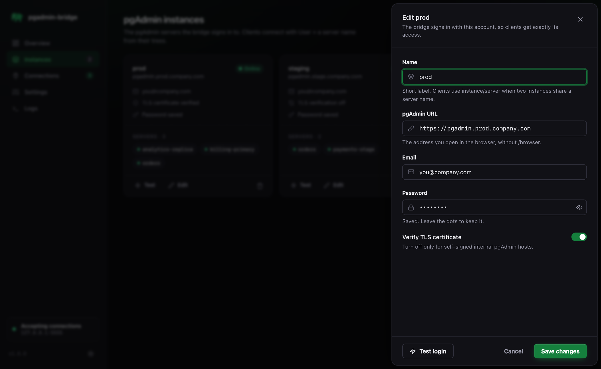
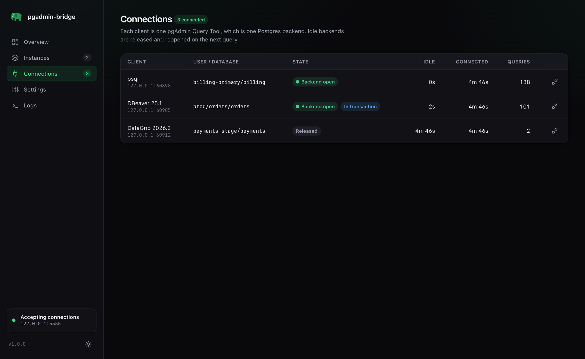
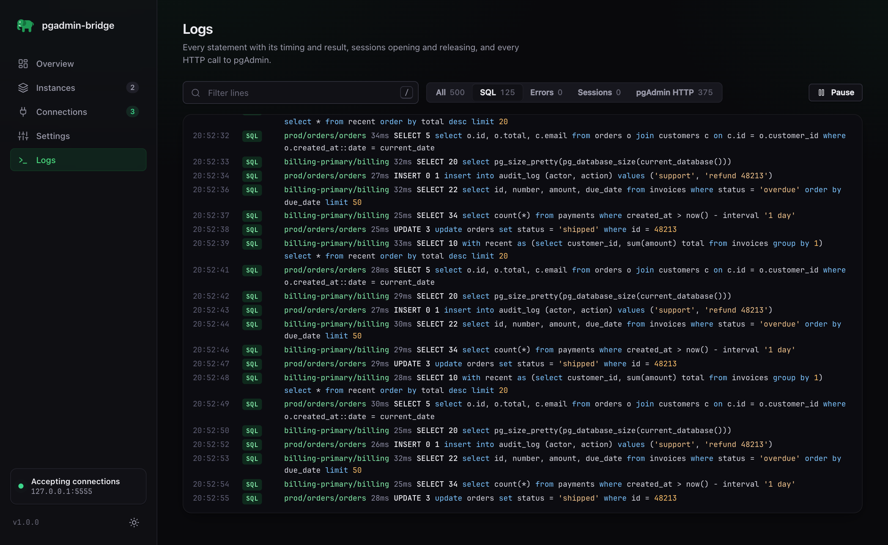

<div align="center">


# pgadmin-bridge

**Use psql, DataGrip, DBeaver or any PostgreSQL client when your company only gives you pgAdmin.**

A PostgreSQL wire-protocol proxy that runs your SQL through pgAdmin 4's Query Tool API.
No direct database port, VPN or SSH bastion needed: if you can open pgAdmin in a browser, your IDE can connect.

[](https://github.com/malinatrash/pgadmin-bridge/actions/workflows/ci.yml)
[](https://github.com/malinatrash/pgadmin-bridge/releases)
[](https://github.com/malinatrash/pgadmin-bridge/pkgs/container/pgadmin-bridge)
[](pyproject.toml)
[](LICENSE)



</div>

## Why

Many companies expose production and staging PostgreSQL **only through a hosted pgAdmin 4**:
the database port is firewalled, there is no VPN route to it, and the only sanctioned access is
the pgAdmin web UI with your corporate account. That is fine for a quick query and painful for
everything else: no DataGrip or DBeaver, no `psql`, no schema-aware autocomplete, no scripts, no
migrations tooling, no running a local app against a staging database.

**pgadmin-bridge** runs next to you (on your laptop, in Docker) and speaks the PostgreSQL protocol
on `127.0.0.1:5432`. Every client connection becomes one pgAdmin Query Tool, signed in with *your*
pgAdmin account. Your client thinks it is talking to Postgres; pgAdmin sees you running queries in
its Query Tool, exactly as if you typed them in the browser.

- **No new access.** It uses the account and the servers you already have in pgAdmin. Nothing on
  the database or pgAdmin side changes, and pgAdmin's own audit log keeps recording every statement.
- **Any client.** psql, DataGrip, DBeaver, TablePlus, pgcli, JDBC/Spring, psycopg, node-postgres,
  Go `pgx`, Rails, Django: anything that speaks the PostgreSQL wire protocol (simple and extended).
- **Zero dependencies.** Pure Python standard library, one small container, a modern web UI to configure it.

## How it works



1. You add a pgAdmin instance in the web UI: its URL plus the email and password you sign in with.
2. The bridge logs in and discovers every server in your pgAdmin tree.
3. A client connects with **User = the server name from the pgAdmin tree** (for example
   `billing-primary`) and **Database = a database on it**.
4. The bridge opens a Query Tool on that server and database (`/sqleditor/initialize`) and runs each
   statement through `/sqleditor/query_tool/start` + `/sqleditor/poll`, streaming rows back to the
   client with real column types.

## Features

- **Full client compatibility**: simple *and* extended query protocol, so JDBC drivers, DataGrip and
  DBeaver work without `preferQueryMode=simple`. Bind parameters are inlined as typed literals; binary
  result formats are produced for int, float, numeric, bool, uuid, bytea, date, time and timestamp.
- **Real Postgres behaviour**: column types, `NOTICE`s, error codes with positions (so your IDE
  highlights the error), transaction status (`BEGIN`/`COMMIT`/`ROLLBACK`), query cancel.
- **Many pgAdmins at once**: prod, staging and the analytics pgAdmin side by side. If two instances
  have a server with the same name, use `instance/server` as the User.
- **Idle backend release**: a forgotten DataGrip tab does not hold a production connection for hours.
  Idle sessions give their backend back and get a fresh one on the next query, with session `SET`s replayed.
- **Guardrails**: optional read-only sessions and a statement timeout applied to every backend.
- **Web UI**: connection-string builder for psql, JDBC, URI and libpq env, live connections with
  one-click disconnect, a searchable SQL and HTTP log, light and dark themes.
- **Persistent**: settings and pgAdmin session cookies live in one volume and survive restarts.
- **Light on pgAdmin**: keep-alive HTTPS connections and gzip, a pool of logins so statements from several
  clients run in parallel, rows streamed to the client as pgAdmin hands them out and fetched in one go
  where pgAdmin supports it. Keepalive pings (`SELECT 1`), `select version()`, `SHOW` of known settings
  and cosmetic `SET`s are answered locally, so an idle IDE tab costs pgAdmin nothing.

## Quick start

### Docker (recommended)

```bash
git clone https://github.com/malinatrash/pgadmin-bridge.git
cd pgadmin-bridge
docker compose up -d
open http://127.0.0.1:8080
```

Or without cloning:

```bash
docker run -d --name pgadmin-bridge --restart unless-stopped \
  -p 127.0.0.1:5432:5432 -p 127.0.0.1:8080:8080 \
  -v pgadmin-bridge-data:/data \
  ghcr.io/malinatrash/pgadmin-bridge:latest
```

The compose file publishes Postgres on host port `5555` (so it never clashes with a local Postgres)
and the web UI on `8080`, both on loopback only. Change them with `BRIDGE_PORT` and `BRIDGE_WEB_PORT`.

### pip

```bash
pip install git+https://github.com/malinatrash/pgadmin-bridge.git
pgadmin-bridge --port 5432 --web-port 8080      # data in ./data
```

### From source

```bash
python3 -m pgadmin_bridge                        # Python 3.11+, no dependencies
```

### First run

1. Open the web UI and go to **Instances**, then **Add instance**: name (`prod`), pgAdmin URL
   (`https://pgadmin.company.com`), your pgAdmin email and password. **Test login** lists the servers it sees.
2. Go to **Settings** and set the **proxy password**. This is what database clients send. It is
   not your pgAdmin password.
3. On **Overview**, pick a server and copy the connection settings into your client.

| Instances | Add or edit a pgAdmin |
|---|---|
|  |  |

## Connect your client

| Field    | Value |
|----------|-------|
| Host     | `127.0.0.1` |
| Port     | `5432` (`5555` with docker compose) |
| User     | the **server name from the pgAdmin tree**, e.g. `billing-primary` (or `prod/billing-primary`) |
| Database | a database on that server; empty means the server's maintenance database |
| Password | the proxy password from Settings |
| SSL      | disabled (`sslmode=disable`): the bridge only listens on loopback |

**psql**

```bash
psql "host=127.0.0.1 port=5432 user=billing-primary dbname=billing sslmode=disable"
```

**DataGrip / IntelliJ**: New data source, then PostgreSQL. Fill in the fields above and set SSL mode
to `disable`. Tips: create one data source per pgAdmin server, introspect only the schemas you need,
and tick *Read-only* for production.

**DBeaver**: New connection, then PostgreSQL. Same fields; on the *SSL* tab leave SSL off.

**JDBC / Spring Boot**

```properties
spring.datasource.url=jdbc:postgresql://127.0.0.1:5432/billing?sslmode=disable
spring.datasource.username=billing-primary
spring.datasource.password=${PGADMIN_BRIDGE_PASSWORD}
```

**Python (psycopg)**

```python
psycopg.connect("host=127.0.0.1 port=5432 user=billing-primary dbname=billing password=... sslmode=disable")
```

## Web UI

| Live connections | SQL and HTTP log |
|---|---|
|  |  |

- **Overview**: counts, a connection-string builder, a getting-started checklist and recent activity.
- **Instances**: add, edit, test and remove pgAdmin instances and see the servers each one exposes.
- **Connections**: every client with its backend state (open or released), open transaction, idle
  time, number of queries, and a disconnect button.
- **Settings**: proxy password, read-only sessions, statement timeout, idle backend release,
  parallel pgAdmin sessions, catalog cache. Applied live, without a restart.
- **Logs**: every statement with timing and result tag, sessions opening and closing, every HTTP
  call to pgAdmin. Filter by kind or search; press `/` to focus the search.

## Configuration

Settings from the web UI are stored in `config.json` in the data directory and applied without a restart.

| Setting | Default | What it does |
|---|---|---|
| Proxy password | (not set) | Password clients must send. Connections are refused until it is set. |
| Read-only sessions | off | Every backend starts with `default_transaction_read_only = on`. |
| Statement timeout | `0` (off) | `statement_timeout` for every backend, in seconds. `120` is a sensible production default. |
| Release idle backend after | `600` s | Closes the Query Tool of an idle client outside a transaction; also sets `idle_in_transaction_session_timeout`. |
| Parallel pgAdmin sessions | `4` | Logins kept per pgAdmin instance. pgAdmin serializes the requests of one login, so this is how many statements run at once across all clients of that instance. |
| Catalog cache | `0` (off) | Seconds to keep results of read-only `pg_catalog` / `information_schema` queries, shared by all clients. Tames the introspection storm of DataGrip and DBeaver. |

Command line and environment:

| Flag | Environment | Default | |
|---|---|---|---|
| `--host` | | `127.0.0.1` | Address for both listeners (`0.0.0.0` in the container) |
| `--port` | | `5432` | PostgreSQL wire port |
| `--web-port` | | `8080` | Web UI port |
| `--advertise HOST:PORT` | `PGADMIN_BRIDGE_ADVERTISE` | listen address | Address shown to users in the UI when ports are remapped |
| | `PGADMIN_BRIDGE_DATA` | `./data` (`/data` in Docker) | Where `config.json` and pgAdmin cookies live |

## Security

pgadmin-bridge does **not** give you access you do not already have. It signs in to pgAdmin as you,
can only reach the servers in your pgAdmin tree, and runs statements through the same Query Tool
endpoints the browser uses, so pgAdmin's permissions, server-side logging and auditing all still apply.
Check that using a local client is in line with your company's access policy before you use it.

- Both listeners bind to loopback by default, and docker compose publishes them on `127.0.0.1` only.
  **Do not expose them to a network**: the web UI has no login of its own, and the proxy password is
  the only thing protecting the Postgres port.
- pgAdmin credentials and session cookies are stored in the data directory with mode `0600`
  (`0700` for the directory). The container runs as an unprivileged user.
- Passwords are never sent back to the browser; the UI only sees a mask.
- Turn on **read-only sessions** and a **statement timeout** for production instances.

To report a vulnerability, see [SECURITY.md](SECURITY.md).

## Limitations

- A batch of several statements returns only the result of the last one (pgAdmin's behaviour).
- Bind parameters are inlined as literals, so every execution is planned separately.
- `COPY`, `LISTEN/NOTIFY`, SSL between client and bridge, and the replication protocol are not supported.
- Every statement costs at least two HTTP round trips to pgAdmin, so expect tens of milliseconds of overhead per query.
- pgAdmin sign-in must be email and password through the login form. OAuth2, Kerberos and other SSO-only setups are not supported yet.

## FAQ

### How do I connect DataGrip to a PostgreSQL database that I can only access through pgAdmin?

Run pgadmin-bridge, add your pgAdmin URL and account in its web UI, then create a regular PostgreSQL
data source in DataGrip pointing at `127.0.0.1:5432` with **User = the server name from the pgAdmin
tree** and the proxy password. DataGrip introspection, autocomplete, the query console and the data
editor all work.

### Can I use psql if I only have pgAdmin access?

Yes: `psql "host=127.0.0.1 port=5432 user=<server-name> dbname=<db> sslmode=disable"`. Meta-commands
like `\dt`, `\d table` and `\x` work because psql sends them as ordinary SQL.

### Does it bypass pgAdmin or database permissions?

No. Every query runs inside a pgAdmin Query Tool opened with your pgAdmin login, against the servers
pgAdmin already lets you use, with the database role pgAdmin connects as. If you cannot do something
in the pgAdmin browser UI, you cannot do it through the bridge.

### How is this different from an SSH tunnel or a VPN?

A tunnel needs network access to the database host. pgadmin-bridge only needs what you already have:
HTTPS access to pgAdmin. It is the option for teams where pgAdmin *is* the bastion.

### Which pgAdmin versions are supported?

pgAdmin 4 version 7 and 8, in server mode, with form login. The test suite runs against a fake
pgAdmin that implements the endpoints the bridge uses.

### Is it fast enough for an IDE?

For interactive work, yes: introspection and queries feel like a database behind a slow VPN. For bulk
loads or high-QPS applications, no: every statement goes through pgAdmin's HTTP API.

### Several people want to use it. Can we run one shared instance?

It is designed as a personal tool: one bridge per person, signed in with that person's pgAdmin
account, so access and audit stay personal. Sharing one instance would make everyone act as one user.

## Development

```bash
python3 -m unittest discover tests -b -v
```

The tests run a raw wire client (and `psql`, when installed) through the bridge into a fake pgAdmin
built on the standard library ([`tests/fake_pgadmin.py`](tests/fake_pgadmin.py)). See
[CONTRIBUTING.md](CONTRIBUTING.md) for the project layout and conventions.

## License

[MIT](LICENSE)
